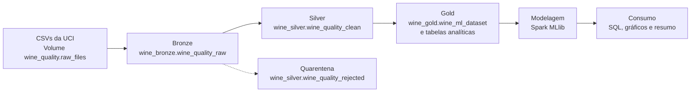
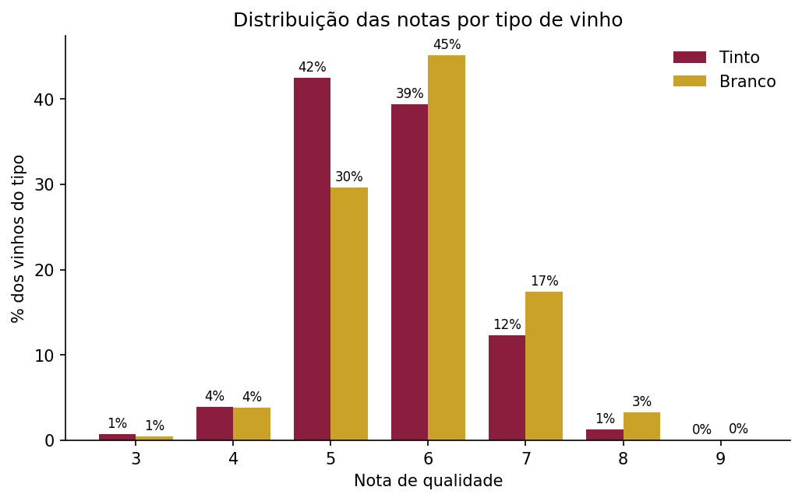
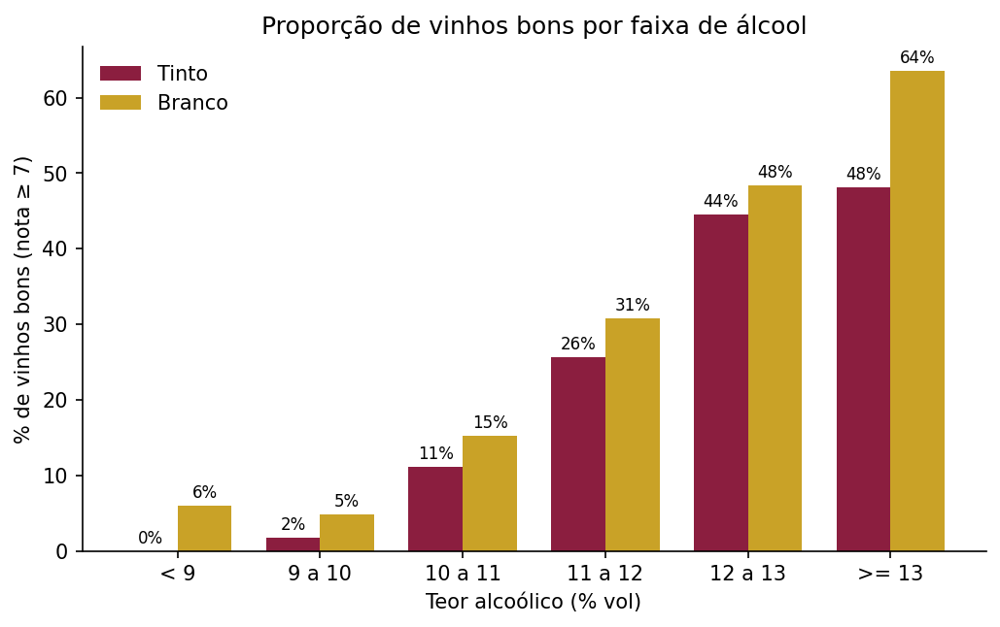
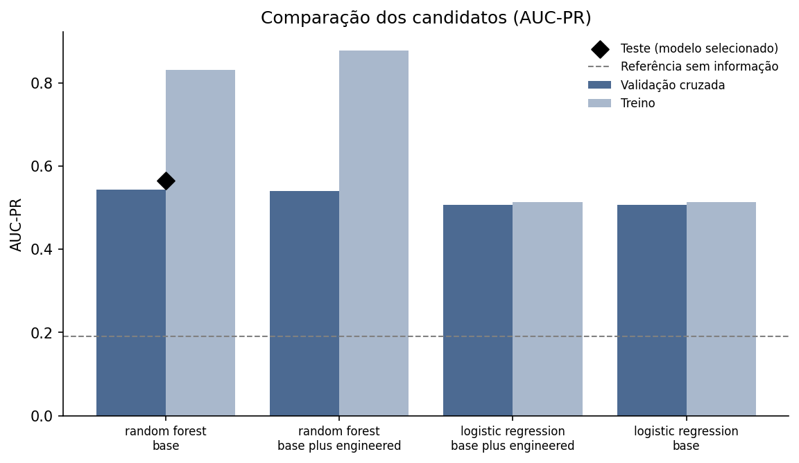
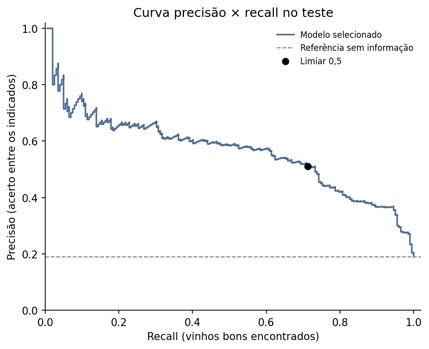
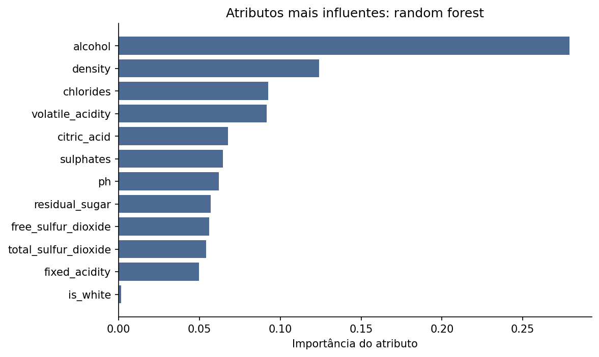

# Data Lakehouse com Databricks: arquitetura medalhão e classificação de qualidade de vinhos

Projeto de ponta a ponta no **Databricks** que organiza a base **Wine Quality** (UCI) em uma arquitetura medalhão
(**Bronze → Silver → Gold**) sobre **Delta Lake** e **Unity Catalog**, e usa a camada Gold para treinar e avaliar um modelo
de classificação com **Spark MLlib** que indica se um vinho tem nota de qualidade igual ou superior a 7.

O objetivo é praticar, de forma reproduzível, como estruturar um fluxo de dados que apoie análise e tomada de decisão:
ingestão, limpeza e validação, preparação de atributos, modelagem responsável e consumo dos resultados.

> **Nota sobre escala.** A base tem 6.497 registros e caberia em qualquer planilha. O projeto não pretende ser um caso de
> big data: ele demonstra o **padrão de engenharia** (camadas, contratos entre notebooks, qualidade de dados, idempotência,
> governança) que escalaria para volumes maiores.

## O que o projeto demonstra

- **Arquitetura medalhão** com um schema por camada no Unity Catalog e arquivos brutos em Volume.
- **Qualidade de dados explícita:** conversão de tipos com `try_cast`, 8 regras de validação, tabela de quarentena e histórico de verificações por execução.
- **Recursos do Delta Lake:** `MERGE` idempotente, restrições `CHECK` e `NOT NULL`, histórico de versões (`DESCRIBE HISTORY`).
- **Modelagem sem vazamento de dados:** remoção de duplicatas exatas, divisão treino/teste estratificada e determinística, validação cruzada só no treino, padronização dentro do `Pipeline`, teste usado uma única vez.
- **Métricas adequadas a classes desbalanceadas** (AUC-PR da classe positiva) e seleção de modelo pela validação cruzada, não pelo teste.
- **Consumo da Gold:** consultas SQL de apoio à decisão, gráficos e um resumo de resultados gerado a partir das próprias tabelas.

## Resultados em resumo

| | |
|---|---|
| Registros de origem | 6.497 (1.599 tintos e 4.898 brancos) |
| Após limpeza | 5.320 (1.359 tintos e 3.961 brancos), com 1.177 duplicatas exatas removidas e 0 registros na quarentena |
| Vinhos bons (nota ≥ 7) | 1.009 (18,97%): 13,5% dos tintos e 20,8% dos brancos |
| Modelo selecionado | Random forest, atributos base (12 atributos) |
| AUC-PR no teste | **0,565** (referência de um modelo sem informação: 0,190) |
| AUC-ROC no teste | 0,859 |
| Limiar 0,5 no teste | precisão 0,511, recall 0,713, F1 0,595 |

O modelo apresenta desempenho moderado: sua AUC-PR (0,565) é aproximadamente três vezes a referência de um classificador sem capacidade discriminativa (prevalência positiva de 0,190). Ainda assim, há limitações importantes de precisão, sobreajuste e calibração, detalhadas nesta documentação.

## Arquitetura



| Camada | Schema | Tabelas | Conteúdo |
|---|---|---|---|
| Origem | `wine_quality` | Volume `raw_files` | CSVs originais, sem alteração |
| Bronze | `wine_bronze` | `wine_quality_raw` | Valores originais como `string`, nomes de colunas em `snake_case` e metadados de ingestão |
| Silver | `wine_silver` | `wine_quality_clean`, `wine_quality_rejected`, `dq_results` | Dados tipados, validados e sem duplicatas exatas; quarentena; histórico de qualidade |
| Gold | `wine_gold` | `wine_ml_dataset`, `ml_feature_catalog`, `quality_summary_by_type`, `quality_by_alcohol_band`, `feature_profile_by_class`, `model_metrics`, `model_predictions`, `model_feature_importance` | Base de modelagem, dicionário de atributos, tabelas analíticas e saídas do modelo |
| Relatórios | `wine_gold` | Volume `reports` | Gráficos, `results_summary.md` e `model_comparison.csv` |

Os notebooks rodaram em **computação serverless do Databricks**, com Unity Catalog (catálogo `workspace`).

## Dados

Base **Wine Quality**, de P. Cortez, A. Cerdeira, F. Almeida, T. Matos e J. Reis. São amostras de vinho verde português,
tinto (1.599) e branco (4.898), com 11 medições físico-químicas e uma nota de qualidade sensorial de 0 a 10
(as notas observadas vão de 3 a 9).

- Download: [UCI Machine Learning Repository, Wine Quality](https://archive.ics.uci.edu/dataset/186/wine+quality)
- Os CSVs **não são versionados** neste repositório. Veja [`data/README.md`](data/README.md) para as instruções.
- Confira a licença na página do dataset.

**Referência:** P. Cortez, A. Cerdeira, F. Almeida, T. Matos e J. Reis. *Modeling wine preferences by data mining from
physicochemical properties.* Decision Support Systems, 47(4):547-553, 2009. https://doi.org/10.1016/j.dss.2009.05.016

## Notebooks

| Notebook | O que faz |
|---|---|
| [`00_setup_catalog_schemas`](notebooks/00_setup_catalog_schemas.py) | Verifica o catálogo, o Volume e os CSVs; cria os schemas das camadas |
| [`01_bronze_ingestion`](notebooks/01_bronze_ingestion.py) | Lê os CSVs e grava a tabela Bronze com metadados de rastreabilidade, de forma idempotente (`replaceWhere`) |
| [`02_silver_cleaning`](notebooks/02_silver_cleaning.py) | Converte tipos, aplica regras de qualidade, envia reprovados à quarentena, remove duplicatas exatas e grava a Silver com `MERGE` |
| [`03_gold_features`](notebooks/03_gold_features.py) | Cria o alvo binário, os atributos, a divisão treino/teste, o catálogo de atributos e as tabelas analíticas |
| [`04_model_training`](notebooks/04_model_training.py) | Treina e compara 4 candidatos com validação cruzada, avalia o selecionado no teste e grava métricas, previsões e importâncias |
| [`05_insights_and_consumption`](notebooks/05_insights_and_consumption.py) | Auditoria do fluxo, gráficos, consultas SQL de apoio à decisão e resumo dos resultados |

## Decisões de projeto

- **Bronze fiel à origem.** Todos os valores ficam como `string`. A única alteração é padronizar os nomes das colunas (o Delta não aceita espaços por padrão). A tipagem é responsabilidade da Silver.
- **Ingestão idempotente.** Na Bronze, `replaceWhere` por arquivo de origem; na Silver, `MERGE` por `wine_id` (hash SHA-256 da chave natural do registro). Reexecutar não duplica nem reescreve dados sem mudança.
- **Quarentena em vez de descarte silencioso.** Registros que violam regras vão para `wine_quality_rejected`, e cada execução registra seus resultados em `dq_results`. Nesta base, nenhuma regra foi violada.
- **Duplicatas exatas removidas.** Linhas idênticas (mesmo tipo, mesmas 11 medições, mesma nota) poderiam cair no treino e no teste ao mesmo tempo e inflar as métricas. A contagem original é preservada na coluna `occurrences`, que não entra no modelo. O notebook 03 também confere que não existem medições idênticas com notas diferentes.
- **Outliers mantidos.** Medições extremas são plausíveis neste tipo de dado. Apenas impossibilidades físicas (por exemplo, pH fora de 0-14 ou SO₂ livre maior que o total) são rejeitadas.
- **Alvo binário `quality >= 7`** ("vinho bom"), o que gera classes desbalanceadas (cerca de 19% positivos).
- **Divisão treino/teste determinística e estratificada** (80%/20% por tipo de vinho e classe), baseada em hash do `wine_id` com semente fixa. O notebook 03 imprime uma "impressão digital" da divisão para provar que ela não muda entre execuções.
- **Sem vazamento na modelagem.** A padronização (`StandardScaler`) é ajustada só com os dados de treino, dentro do `Pipeline`. Os pesos de classe são recalculados dentro de cada ajuste da validação cruzada, sem usar rótulos do fold de validação.
- **Validação cruzada manual e estratificada** (3 folds, criados por hash do `wine_id`), com AUC-PR como critério.
- **Seleção pela validação cruzada, nunca pelo teste.** O conjunto de teste é avaliado **uma única vez**, apenas para o candidato selecionado.
- **Contrato entre notebooks.** O catálogo de atributos (`ml_feature_catalog`) informa o papel de cada coluna (`feature`, `target`, `metadata`), e o notebook de modelagem lê daí os atributos, em vez de repetir listas no código.

## Resultados detalhados

### Qualidade dos dados

Das 6.497 linhas de origem, **1.177 (18,1%)** eram duplicatas exatas (240 no tinto e 937 no branco). Depois da remoção, restaram
5.320 registros únicos. A reconciliação entre camadas fecha: Bronze = Silver (contando as ocorrências originais) + quarentena.

**Idempotência.** Em execuções repetidas do notebook 02, as operações `MERGE` registradas no histórico Delta da Silver mostraram
**0 linhas inseridas, atualizadas e removidas**, com 5.320 linhas na origem. Reprocessar a Silver não altera dados que não mudaram.

### Perfil das notas



A maioria dos vinhos concentra-se nas notas 5 e 6. A nota 9 aparece apenas no vinho branco e em pouquíssimos registros.

### Álcool e qualidade



A proporção de vinhos bons cresce de forma consistente com o teor alcoólico nos dois tipos:

| Faixa de álcool (% vol) | Tinto: registros | Tinto: % bons | Branco: registros | Branco: % bons |
|---|---|---|---|---|
| < 9 | 6 | 0,0% | 199 | 6,0% |
| 9 a 10 | 570 | 1,8% | 1.226 | 4,8% |
| 10 a 11 | 379 | 11,1% | 1.083 | 15,2% |
| 11 a 12 | 258 | 25,6% | 751 | 30,8% |
| 12 a 13 | 119 | 44,5% | 581 | 48,4% |
| ≥ 13 | 27 | 48,1% | 121 | 63,6% |

Esta é uma **associação descritiva**, e não prova que o álcool cause a qualidade. Algumas faixas têm poucos registros
(por exemplo, 6 tintos abaixo de 9% e 27 tintos a partir de 13%), então os percentuais dessas faixas são pouco estáveis.

### Modelagem

Foram comparados 4 candidatos: dois algoritmos (regressão logística e random forest) × dois conjuntos de atributos
(`base`, com as 11 medições e o tipo de vinho, e `base_plus_engineered`, que acrescenta a fração de SO₂ livre e a soma das acidezes).

| Modelo | Atributos | AUC-PR (validação cruzada) | AUC-PR (treino) |
|---|---|---|---|
| **Random forest** (selecionado) | base | **0,544** | 0,831 |
| Random forest | base + derivados | 0,540 | 0,878 |
| Regressão logística | base + derivados | 0,507 | 0,514 |
| Regressão logística | base | 0,507 | 0,513 |



- O modelo selecionado foi um random forest com `numTrees = 100`, `maxDepth = 10` e `minInstancesPerNode = 5`.
- Os **atributos derivados não ajudaram**: a diferença na validação cruzada é desprezível (0,540 contra 0,544) e o sobreajuste aumentou. A hipótese foi testada e descartada.
- O random forest **sobreajusta** (AUC-PR de 0,83 no treino contra 0,54 na validação cruzada). O resultado no teste (0,565) ficou alinhado com a validação cruzada.

**Desempenho no teste** (1.064 vinhos, dos quais 202 bons), limiar 0,5:

| AUC-PR | AUC-ROC | Precisão | Recall | F1 | Acurácia balanceada | Acurácia |
|---|---|---|---|---|---|---|
| 0,565 | 0,859 | 0,511 | 0,713 | 0,595 | 0,776 | 0,816 |

| Matriz de confusão | Previsto: não bom | Previsto: bom |
|---|---|---|
| **Real: não bom** | 724 | 138 |
| **Real: bom** | 58 | 144 |



**Por tipo de vinho** (modelo único para os dois tipos):

| Tipo | Vinhos no teste | Vinhos bons | Verdadeiros positivos | Falsos positivos | Recall | Precisão |
|---|---|---|---|---|---|---|
| Tinto | 272 | 37 | 23 | 13 | 0,622 | 0,639 |
| Branco | 792 | 165 | 121 | 125 | 0,733 | 0,492 |

O desempenho é diferente entre os tipos: no branco o modelo encontra mais vinhos bons, mas com mais falsos positivos.

### Atributos mais influentes



| Atributo | Importância |
|---|---|
| alcohol | 0,279 |
| density | 0,124 |
| chlorides | 0,093 |
| volatile_acidity | 0,092 |
| citric_acid | 0,068 |
| sulphates | 0,065 |
| ph | 0,062 |
| residual_sugar | 0,057 |
| free_sulfur_dioxide | 0,056 |
| total_sulfur_dioxide | 0,054 |
| fixed_acidity | 0,050 |
| is_white | 0,002 |

O álcool lidera com folga. **Cuidado na interpretação:** a densidade é fisicamente correlacionada com o álcool e o açúcar,
e a importância de florestas aleatórias divide o peso entre atributos correlacionados, então ela não deve ser lida como um efeito
independente da densidade. Também chama atenção que o tipo de vinho (`is_white`) quase não é usado pelo modelo.

### Apoio à decisão

Consultas SQL sobre as tabelas Gold mostram como o modelo poderia apoiar uma triagem. Os resultados abaixo são **descritivos**,
calculados no conjunto de teste, e não devem ser usados para escolher um limiar (isso exigiria validação).

**Cenário de revisão:** se apenas os vinhos com probabilidade acima de um limiar fossem separados para uma avaliação mais cuidadosa:

| Limiar | Vinhos revisados | % do total revisado | Bons encontrados | % dos bons encontrados | Acerto entre os indicados |
|---|---|---|---|---|---|
| 0,3 | 461 | 43,3% | 176 | 87,1% | 38,2% |
| 0,4 | 374 | 35,2% | 159 | 78,7% | 42,5% |
| 0,5 | 282 | 26,5% | 144 | 71,3% | 51,1% |
| 0,6 | 213 | 20,0% | 122 | 60,4% | 57,3% |
| 0,7 | 136 | 12,8% | 81 | 40,1% | 59,6% |
| 0,8 | 61 | 5,7% | 40 | 19,8% | 65,6% |

Com o limiar de 0,5, revisar 26,5% dos vinhos permitiria encontrar 71,3% dos bons. Limiares mais altos revisam menos vinhos e
acertam mais entre os indicados, mas deixam escapar mais vinhos bons.

**Taxa real por faixa de probabilidade:**

| Faixa de probabilidade | Vinhos | Realmente bons | % realmente bons | Probabilidade média prevista |
|---|---|---|---|---|
| 0,0 a 0,2 | 514 | 10 | 1,9% | 0,073 |
| 0,2 a 0,4 | 176 | 33 | 18,8% | 0,299 |
| 0,4 a 0,6 | 161 | 37 | 23,0% | 0,494 |
| 0,6 a 0,8 | 152 | 82 | 53,9% | 0,697 |
| 0,8 a 1,0 | 61 | 40 | 65,6% | 0,850 |

O modelo **ordena bem** os vinhos: a proporção de bons cresce a cada faixa, e 48% dos vinhos do teste caem na faixa mais baixa,
que contém apenas 10 dos 202 vinhos bons. Porém as probabilidades **não são calibradas** (por exemplo, na faixa de 0,4 a 0,6 a
probabilidade média prevista é 0,49, mas só 23% eram realmente bons), efeito esperado do treino com pesos de classe. Elas servem
para ordenar, e não para ler como chance real.

## Limitações e cuidados de interpretação

- **Poucos vinhos bons no teste (202).** As métricas têm incerteza considerável, principalmente para o vinho tinto (37 vinhos bons no teste).
- **Sobreajuste do random forest** e **grade de hiperparâmetros curta:** os valores escolhidos (`maxDepth = 10` e `minInstancesPerNode = 5`) estão no limite superior da grade testada (`[6, 10]` e `[1, 5]`). Uma grade maior poderia melhorar o resultado.
- **Limiar fixo de 0,5.** Em uso real, o limiar deveria ser escolhido por validação, conforme o custo de errar em cada direção.
- **Probabilidades não calibradas**, por causa dos pesos de classe.
- **A nota é subjetiva.** `quality` vem de avaliações sensoriais, o que limita o quanto ela pode ser prevista por medições físico-químicas.
- **Associação, não causalidade.** Tanto a relação com o álcool quanto a importância dos atributos descrevem o que os dados e o modelo mostram, não o que causa qualidade.
- **Um único particionamento treino/teste.** Repetir o experimento com outras sementes mostraria a estabilidade dos resultados.
- **Escala.** Uma base de 6.497 linhas não exige um lakehouse; o projeto demonstra o padrão, e não ganhos de desempenho.

## Como reproduzir

**Requisitos:** um workspace Databricks com Unity Catalog e computação serverless (por exemplo, o Databricks Free Edition).
O Community Edition foi descontinuado em 1º de janeiro de 2026.

1. **Baixe os dados** (`winequality-red.csv` e `winequality-white.csv`) na [UCI](https://archive.ics.uci.edu/dataset/186/wine+quality).
2. **Importe os notebooks** da pasta `notebooks/` para o workspace (`Import` → arquivo `.py`).
3. **Crie o schema de origem e o Volume** (em uma célula SQL):
   ```sql
   CREATE SCHEMA IF NOT EXISTS workspace.wine_quality;
   CREATE VOLUME IF NOT EXISTS workspace.wine_quality.raw_files;
   ```
4. **Faça o upload dos dois CSVs** para o Volume: `Catalog` → `workspace` → `wine_quality` → `raw_files` → *Upload to this volume*.
5. **Execute os notebooks na ordem**, de `00` a `05`. Cada um verifica os pré-requisitos e interrompe com mensagem clara se faltar alguma etapa anterior.
6. Os gráficos e o resumo são gravados no Volume `workspace.wine_gold.reports`.

Se o seu catálogo não se chamar `workspace`, altere a variável `CATALOG` no início de cada notebook.

O pipeline é determinístico: a divisão treino/teste e os folds usam hash com semente fixa, e os modelos usam semente fixa.
Os resultados podem variar ligeiramente se a versão do ambiente for diferente.

## Estrutura do repositório

```
databricks-wine-lakehouse/
├── README.md
├── notebooks/
│   ├── 00_setup_catalog_schemas.py
│   ├── 01_bronze_ingestion.py
│   ├── 02_silver_cleaning.py
│   ├── 03_gold_features.py
│   ├── 04_model_training.py
│   └── 05_insights_and_consumption.py
├── docs/
│   └── figures/
│       ├── 01_quality_distribution.png
│       ├── 02_good_wines_by_alcohol.png
│       ├── 03_model_comparison.png
│       ├── 04_feature_importance.png
│       └── 05_precision_recall_curve.png
└── data/
    ├── README.md
    └── winequality.names
```

## Autoria

Talita Luci da Silva ([@TalitaLuci](https://github.com/TalitaLuci)).
